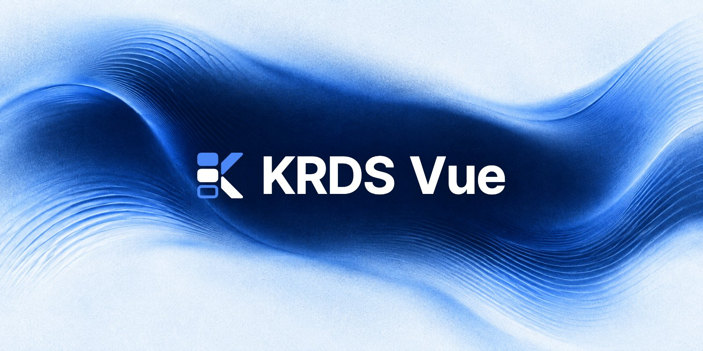
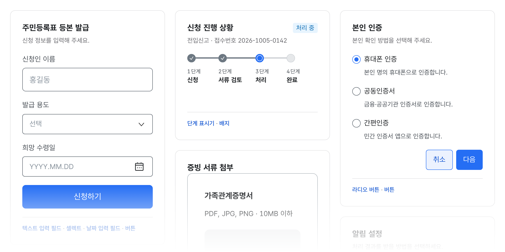

<p align="center">
  <a href="https://krds.initializer.org/">
    
  </a>
</p>

<div align="center">

[](https://www.npmjs.com/package/@krds.ui/vue)
[](https://www.npmjs.com/package/@krds.ui/vue)
[](https://github.com/Initializer-org/krds-vue/actions/workflows/ci.yml)
[](https://www.npmjs.com/package/@krds.ui/vue)
[](https://vuejs.org/)
[](https://github.com/KRDS-uiux/krds-uiux)
[](https://opensource.org/licenses/MIT)

</div>

<hr />
<div align="center">

<a href="https://krds.initializer.org/">문서</a>
<span>&nbsp;&nbsp;•&nbsp;&nbsp;</span>
<a href="https://krds.initializer.org/guide/getting-started">시작하기</a>
<span>&nbsp;&nbsp;•&nbsp;&nbsp;</span>
<a href="https://krds.initializer.org/components/">컴포넌트</a>
<span>&nbsp;&nbsp;•&nbsp;&nbsp;</span>
<a href="https://krds.initializer.org/playground">플레이그라운드</a>
<span>&nbsp;&nbsp;•&nbsp;&nbsp;</span>
<a href="https://krds.initializer.org/guide/ai">AI로 개발하기</a>

</div>
<hr />

## KRDS Vue: 대한민국 정부 디자인 시스템을 Vue 3로

[KRDS(대한민국 정부 디자인 시스템)](https://www.krds.go.kr/html/site/index.html)를 Vue 3 + TypeScript로 구현한 컴포넌트 라이브러리입니다. 공공 웹서비스에서 반복되는 폼, 내비게이션, 레이아웃, 피드백 UI를 KRDS 원본과 같은 모습과 동작으로 제공합니다.

- **KRDS 원본 그대로.** KRDS 원본 저장소 v1.1.0의 마크업·클래스·키보드 동작을 기준으로 포팅했습니다. [공식 컴포넌트 55종](https://www.krds.go.kr/html/site/component/component_summary.html) 중 52종을 포함해 58개 컴포넌트를 제공합니다.
- **접근성 자동 검사.** 모든 컴포넌트 테스트가 실제 브라우저에서 axe-core 접근성 검사를 실행하고, 위반이 있으면 CI가 실패합니다. 고대비 모드를 지원합니다.
- **필요한 만큼만.** ESM·Tree-shaking으로 쓰는 컴포넌트만 번들에 포함됩니다. TypeScript 타입 정의와 Nuxt 서버 렌더링을 지원합니다.

[](https://krds.initializer.org/)

## 빠른 시작

```bash
pnpm add @krds.ui/vue
```

```ts
import { createApp } from 'vue'
import KrdsVue from '@krds.ui/vue'
import '@krds.ui/vue/style'
import App from './App.vue'

createApp(App).use(KrdsVue).mount('#app')
```

Vue `^3.5.0`과 ESM을 지원하는 번들러가 필요합니다(CommonJS `require()`는 지원하지 않음). 개별 import, Nuxt, 전역 타입, 테마, 브라우저 지원은 [시작하기](https://krds.initializer.org/guide/getting-started)를 참고하세요.

위 설정을 담은 Vite 예제가 [`examples/vite`](./examples/vite)에 있습니다.

[](https://stackblitz.com/github/Initializer-org/krds-vue/tree/main/examples/vite)

## 접근성

라이브러리 차원의 자동 검사는 KWCAG/WCAG 적합성 평가를 대체하지 않습니다. 서비스 전체의 접근성 준수는 사용처에서 별도로 검증해야 합니다.

## 버전 정책

- 시맨틱 버저닝을 따르며, [release-please](https://github.com/googleapis/release-please)가 Conventional Commits로 릴리스 PR을 만들고 머지되면 npm에 배포합니다. 변경 이력은 [CHANGELOG](./CHANGELOG.md)에 있습니다.
- [KRDS 원본 저장소](https://github.com/KRDS-uiux/krds-uiux) v1.1.0(2026-01-12 커밋 `d6bb184`)을 기준으로 합니다. 원본을 반영하면서 마크업·클래스 구조가 바뀌어 호환성이 깨지면 메이저 버전으로만 배포하고 CHANGELOG에 마이그레이션 노트를 남깁니다.

## 기여하기

**버그와 기능 요청**은 [이슈](https://github.com/Initializer-org/krds-vue/issues)로 남겨 주세요. 큰 변경은 이슈에서 먼저 논의해 주세요.

**보안 취약점**은 공개 이슈 대신 [SECURITY](./SECURITY.md)의 방법으로 알려 주세요.

개발 환경과 규칙은 [CONTRIBUTING](./.github/CONTRIBUTING.md)에 있습니다.

## 라이선스

MIT © [Initializer Team](https://github.com/Initializer-org)
